# argo9s

A [K9s](https://github.com/derailed/k9s)-style terminal UI for [Argo CD](https://argo-cd.readthedocs.io/): watch your Applications in real time, drill from ApplicationSets, projects and clusters down to the pods they run, read logs, open a shell, and sync — without leaving the terminal.

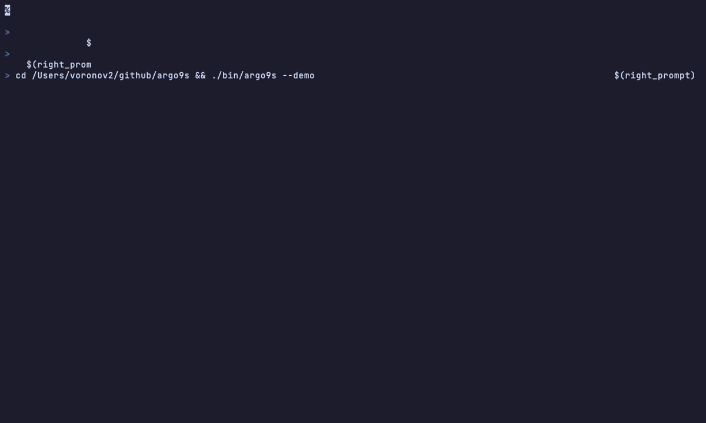

Try it without a cluster: `argo9s --demo` (offline sample data — every screenshot below comes from it).

## Contents

- [Features](#features)
- [Install](#install)
- [Quick start](#quick-start)
- [Connections](#connections)
- [A tour of the views](#a-tour-of-the-views)
- [Keybindings](#keybindings)
- [Commands](#commands)
- [Filters and search](#filters-and-search)
- [Colors and markers](#colors-and-markers)
- [Actions and read-only mode](#actions-and-read-only-mode)
- [CLI](#cli)
- [Config](#config)
- [How it works](#how-it-works)
- [Development](#development)

## Features

- **Two backends** — Kubernetes (kubeconfig / in-cluster, watches the Argo CD CRDs) **or** the Argo CD HTTP API (server URL + token).
- **Named connections** in `~/.argo9s/config.yaml`, a startup picker, and `:ctx` to switch Argo CD instance or cluster without restarting.
- **Applications first** — the app list is the home screen; ApplicationSets, projects and destination clusters are views you drill through to reach their apps.
- **Per-view columns** — each view shows what matters for it (cluster and appset for apps, app counts for appsets / projects / clusters).
- **Managed resources tree** — `enter` on an app lists every object it manages, expandable: Deployment ▸ ReplicaSet ▸ Pod, CRDs, Services…
- **Fullscreen resource graph** — `g` lays the app out left → right (Argo CD UI style) with `/` search, jump-to-next-issue and per-node actions.
- **Pod logs and shell** — with a container picker for multi-container pods.
- **Describe** — destination, sources, sync policy, **last sync result with per-resource errors**, and **sync history**.
- **Colored YAML** and live edit through `$EDITOR` (read-write connections).
- **K9s-style UX** — `j`/`k`, `/` regex filters, `:` commands, crumbs, `esc` to go back, `ctrl+c` from anywhere, a hint when Caps Lock is on.
- **Version info** in the header: argo9s, Argo CD, and Kubernetes (on Kubernetes connections).
- **Read-only by default**; actions (sync, refresh, suspend/resume, delete) need a read-write connection.
- `--no-color` / `NO_COLOR=1` for monochrome terminals.

## Install

### Homebrew

```bash
brew install vvrnv/tap/argo9s
```

### Go

```bash
go install github.com/vvrnv/argo9s/cmd/argo9s@latest
```

### Binary

Download from the [releases](https://github.com/vvrnv/argo9s/releases) page (Linux, macOS, Windows).

### Build from source

Requires Go 1.27+.

```bash
git clone https://github.com/vvrnv/argo9s.git
cd argo9s
make build
./bin/argo9s
```

Releases are published automatically on `v*` tags via GoReleaser (GitHub Release + Homebrew formula in [vvrnv/homebrew-tap](https://github.com/vvrnv/homebrew-tap)).

## Quick start

```bash
argo9s --demo                                                # offline sample data
argo9s                                                       # current kubeconfig context (or the picker)
argo9s --server https://argocd.example.com --auth-token "$TOKEN"   # Argo CD API
```

Then: `j`/`k` to move, `enter` to drill in, `d` to describe, `g` for the graph, `/` to filter, `:` for commands, `?` for help, `esc` to go back.

## Connections

### 1) CLI (one-shot Argo CD API)

```bash
argo9s --server https://argocd.example.com --auth-token "$TOKEN"
argo9s --server https://argocd.example.com --auth-token "$TOKEN" --insecure
# token also from ARGOCD_AUTH_TOKEN
```

### 2) Config profiles + picker

```bash
argo9s config init          # writes example ~/.argo9s/config.yaml
# edit connections, put tokens in env vars
export ARGOCD_TEST_TOKEN=...
export ARGOCD_PROD_TOKEN=...
argo9s                      # picker: kubernetes / argocd-test / argocd-prod
argo9s --connection argocd-prod
argo9s --pick               # force picker
```

Example `~/.argo9s/config.yaml`:

```yaml
defaultConnection: kubernetes
connections:
  - name: kubernetes
    type: kubernetes
  - name: argocd-test
    type: argocd
    server: https://argocd.test.example.com
    tokenEnv: ARGOCD_TEST_TOKEN
    readOnly: false
  - name: argocd-prod
    type: argocd
    server: https://argocd.prod.example.com
    tokenEnv: ARGOCD_PROD_TOKEN
    readOnly: true
```

`readOnly` on a connection overrides the global `readOnly`. CLI `--readonly` still wins when passed explicitly.

### 3) Kubernetes / in-cluster

```bash
argo9s --connection kubernetes
argo9s --context my-cluster -n argocd
```

Inside the TUI, `:ctx` lists every configured connection; `enter` switches to it (see [Contexts](#contexts)).

## A tour of the views

### Applications

The home screen. Every Argo CD Application with its sync and health status, destination **cluster**, the **ApplicationSet** that generated it, project, revision and age. The header shows the connection, read-only state, versions and object counts; the key menu next to it always reflects the current view.

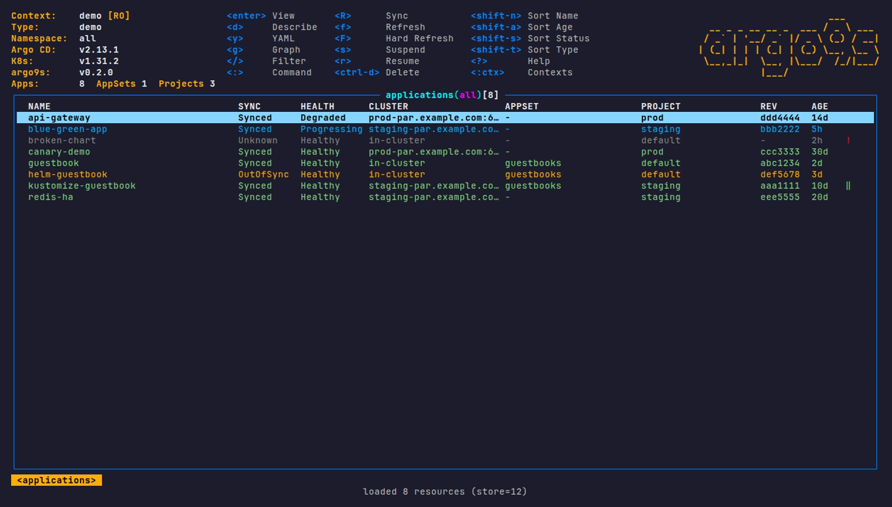

### Filter

`/` filters live as you type — a case-insensitive regex over name, namespace, project, status and conditions (`!text` inverts). The frame title shows the active filter; `esc` clears it.

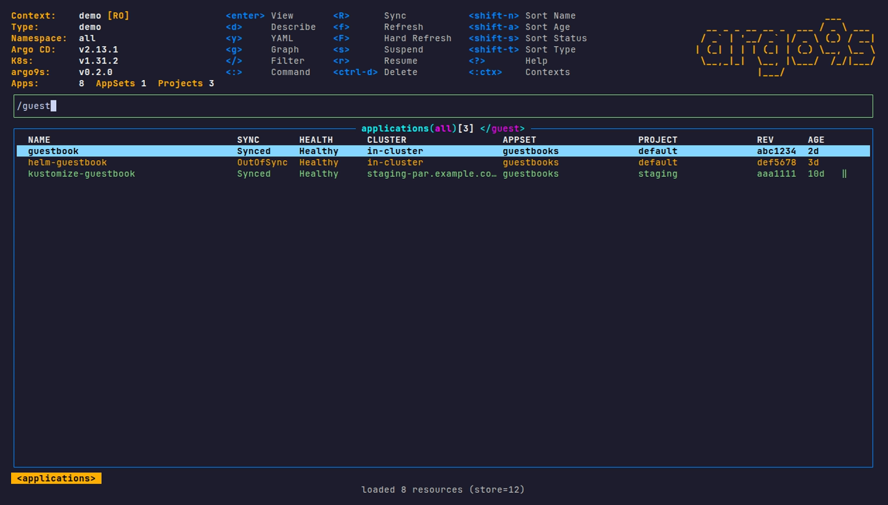

### ApplicationSets

`:appsets` lists ApplicationSets with their generation status and how many apps each one owns. Only real problems color a row (an `ErrorOccurred=True` condition), not the informational conditions every healthy appset carries.

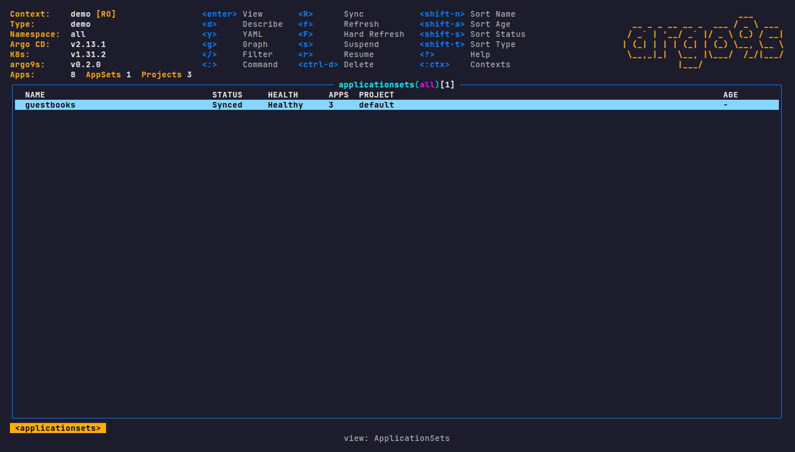

`enter` on an appset lists the Applications it generated (matched by owner reference). The crumbs at the bottom show where you are; `esc` goes back.

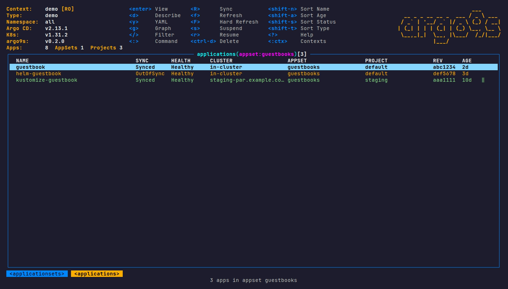

### Projects

`:projects` lists AppProjects with their description and app count; `enter` lists the project's apps. `d` shows its source repos and destinations.

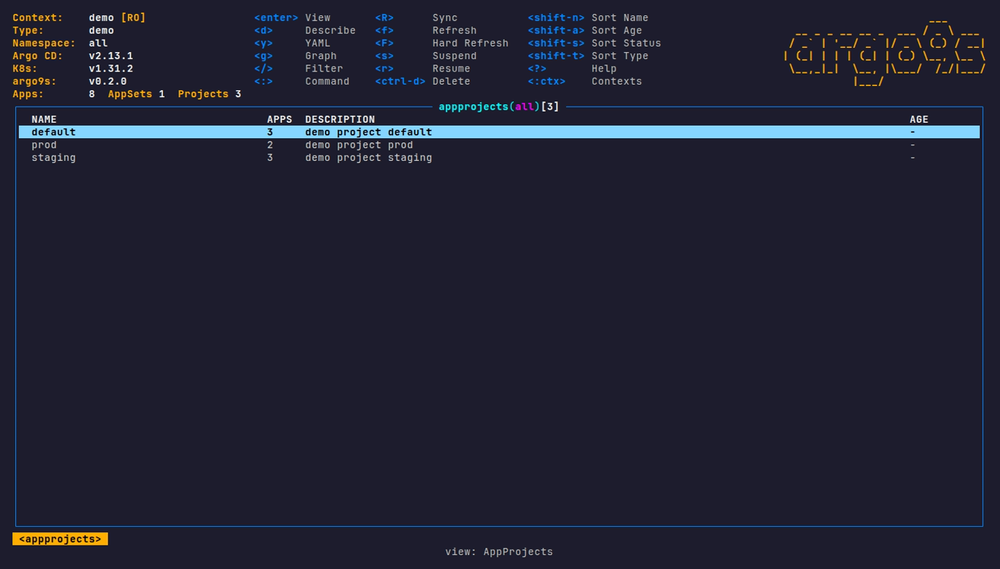

### Clusters

`:clusters` groups Applications by destination cluster, with the worst sync / health among them; `enter` lists the apps deployed there.

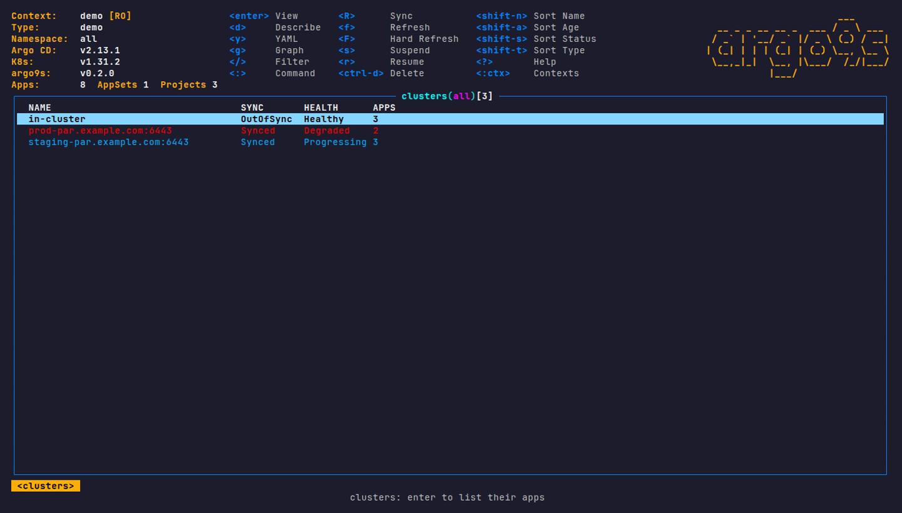

### Contexts

`:ctx` lists the connections from your config (plus the current one). `enter` reconnects to another Argo CD instance or cluster without leaving argo9s.

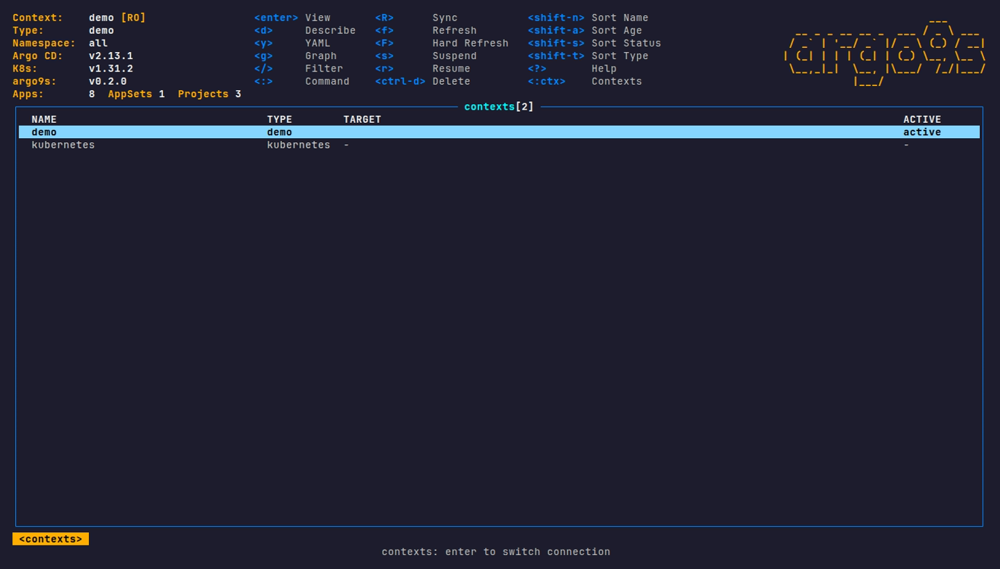

### Describe

`d` on an app: destination, sources, sync policy, the **last sync** (phase, message, and every resource that failed to sync) and the **sync history**, newest first. On appsets and projects it lists their applications.

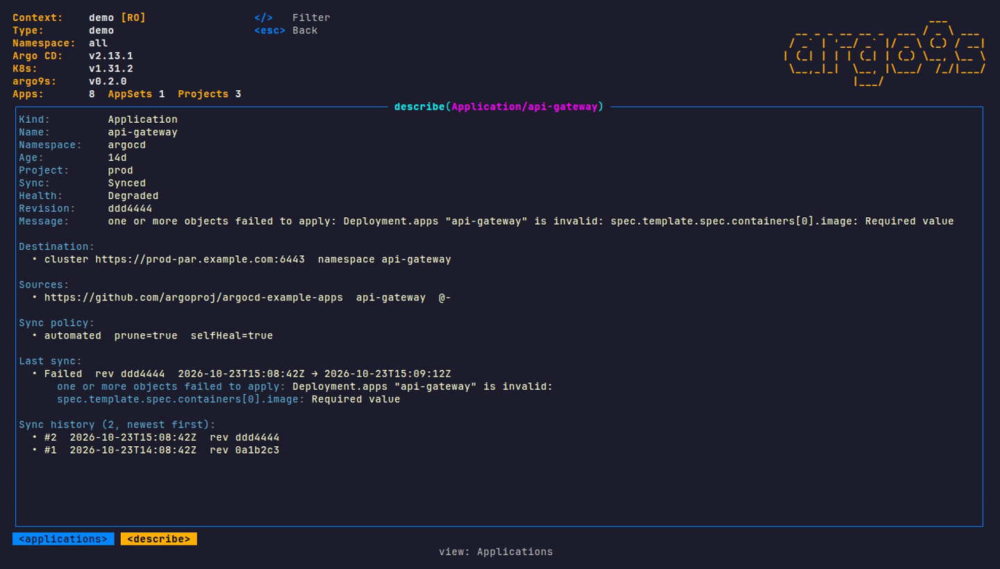

### YAML

`y` shows the live manifest with YAML coloring. `/` keeps matching lines, `h`/`l` scroll long lines, `e` edits in `$EDITOR` and applies (read-write connections).

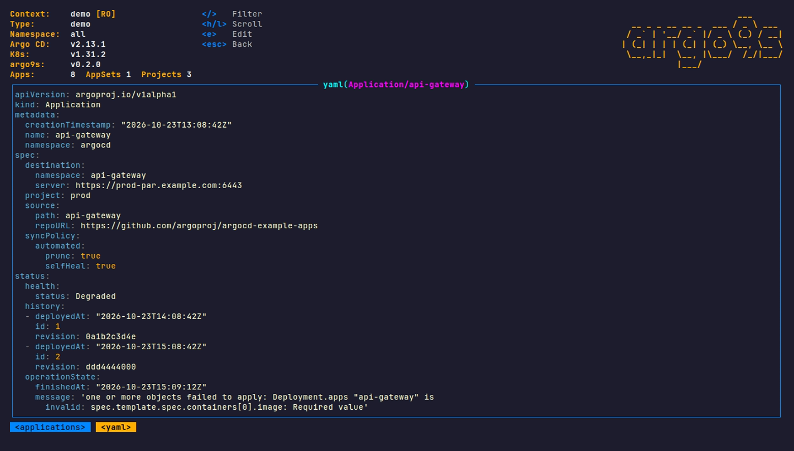

### Managed resources tree

`enter` on an app lists every object it manages. Workloads expand into their ReplicaSets and Pods (`enter`, `space`, `→`); `←` collapses or jumps to the parent. Old ReplicaSets left by previous rollouts (`0/0`) are hidden — `o` shows them. `d`, `y`, `e` act on the selected object.

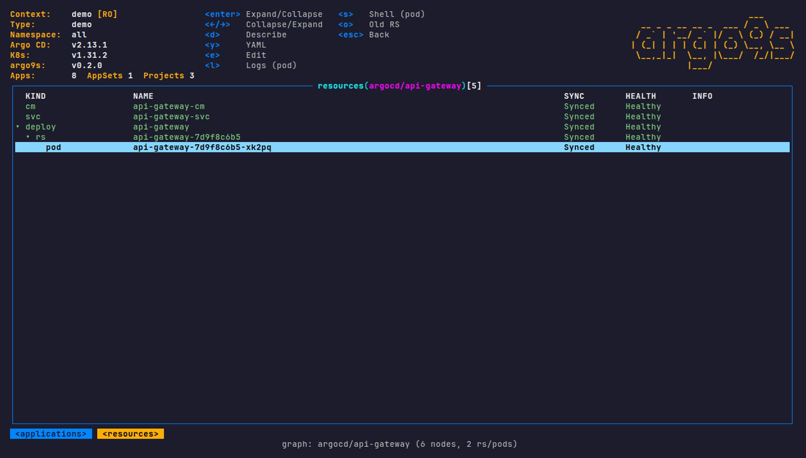

### Logs and containers

`l` on a pod streams its logs. When the pod runs several containers, argo9s asks which one first (the `kubectl.kubernetes.io/default-container` one is listed first). In the logs, `/` filters lines, `p` switches to the previous container's logs after a restart.

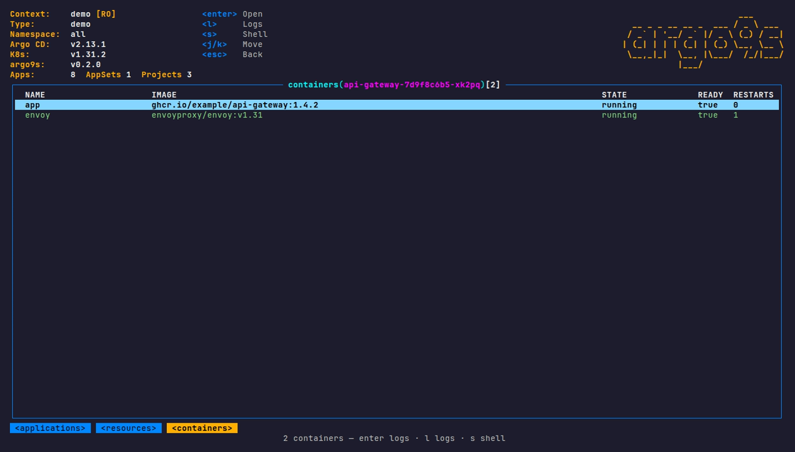

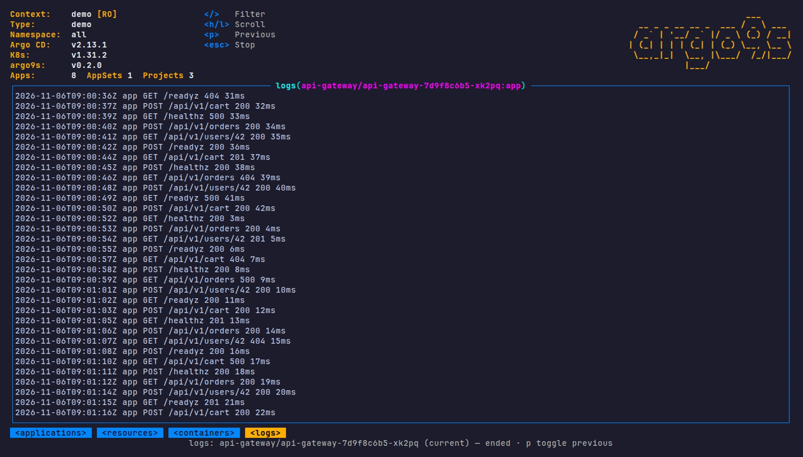

### Shell

`s` on a pod (tree or graph) opens an interactive shell — bash if the image has it, sh otherwise — with the same container picker. argo9s hands the terminal over and comes back when you `exit`. Needs a Kubernetes connection: the shell is not available over the Argo CD API yet.

### Resource graph

`g` on an app opens the graph fullscreen, laid out left → right like the Argo CD UI. The path from the selected object up to the app is drawn in bold orange; the bottom line details the selection.

- `h`/`l` parent / child and `j`/`k` up / down follow the drawing; `pgup`/`pgdn`, `home`/`end` jump within a column.
- `tab` / `shift-tab` jump to the next object that needs attention (degraded, progressing, out of sync, pod not running).
- `d` describe, `y` YAML, `e` edit, `l` logs, `s` shell, `o` old ReplicaSets.
- Below 100 columns, `g` opens the tree instead — boxes would not fit.

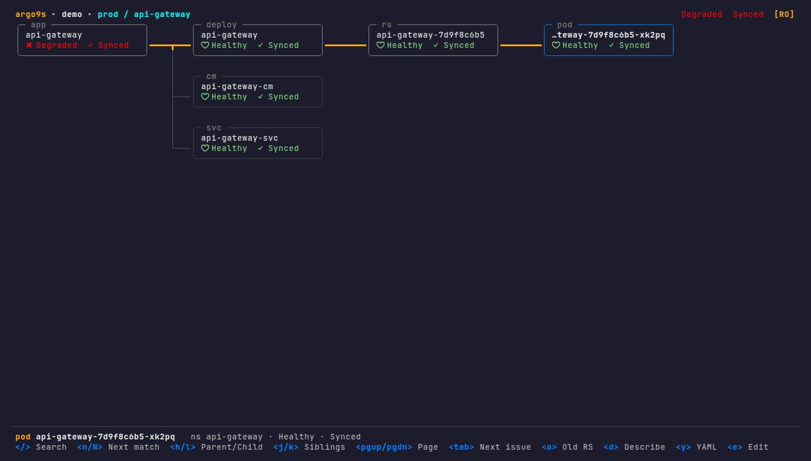

`/` searches objects by kind and name: the cursor jumps to the first match, other matches are framed, `n`/`N` cycle through them and the top line shows `</query> 1/3`.

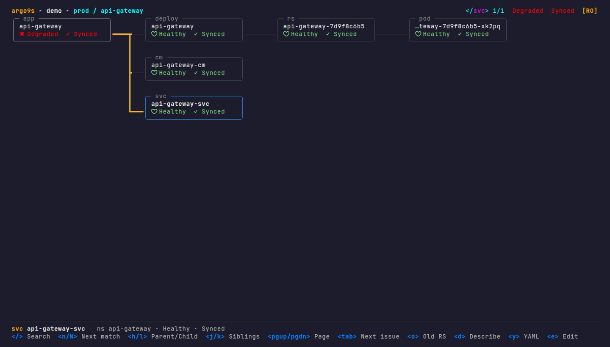

### Help

`?` lists every key and command.

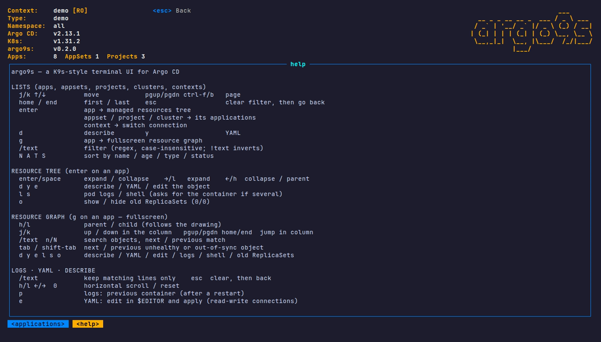

## Keybindings

Keys are lowercase; argo9s warns when Caps Lock seems to be on. `ctrl+c` quits from anywhere.

### Lists (applications, appsets, projects, clusters, contexts)

| Key | Action |
|-----|--------|
| `j` / `k`, `↑` / `↓` | Move |
| `pgup` / `pgdn`, `ctrl+b` / `ctrl+f` | Page |
| `home` / `end` | First / last row |
| `enter` | App: resource tree · appset / project / cluster: its apps · context: switch |
| `d` | Describe |
| `y` | YAML |
| `g` | Resource graph (applications) |
| `/` | Filter (`esc` clears it) |
| `:` | Command |
| `N` / `A` / `T` / `S` | Sort by name / age / type / status |
| `esc` | Clear filter, then leave the drill-down |
| `?` | Help |
| `Q` / `:q` / `ctrl+c` | Quit |

### Resource tree

| Key | Action |
|-----|--------|
| `enter` / `space` | Expand / collapse |
| `→` / `l` | Expand (`l` on a pod: logs) |
| `←` / `h` | Collapse, or go to the parent |
| `d` / `y` / `e` | Describe / YAML / edit the object |
| `l` / `s` | Pod logs / shell |
| `o` | Show / hide old ReplicaSets |
| `esc` | Back |

### Resource graph

| Key | Action |
|-----|--------|
| `h` / `l` | Parent / child (`l` on a pod: logs) |
| `j` / `k` | Up / down in the column |
| `pgup` / `pgdn`, `home` / `end` | Jump within the column |
| `g` / `G` | The app / the last object |
| `/` then `n` / `N` | Search, next / previous match |
| `tab` / `shift-tab` | Next / previous object needing attention |
| `d` / `y` / `e` | Describe / YAML / edit |
| `s` | Shell (pod) |
| `o` | Show / hide old ReplicaSets |
| `esc` | Clear search, then back |

### Logs, YAML, describe

| Key | Action |
|-----|--------|
| `/` | Keep matching lines (`esc` clears) |
| `j` / `k`, `pgup` / `pgdn`, `home` / `end` | Scroll |
| `h` / `l`, `0` | Horizontal scroll / reset |
| `p` | Logs: previous container |
| `e` | YAML: edit in `$EDITOR` and apply |
| `esc` | Back |

### Container picker

| Key | Action |
|-----|--------|
| `enter` | Logs or shell, whichever opened the picker |
| `l` / `s` | Logs / shell |

### Actions (applications, read-write connections)

| Key | Action |
|-----|--------|
| `R` | Sync |
| `f` / `F` | Refresh / hard refresh |
| `s` / `r` | Suspend (manual sync) / resume auto-sync |
| `ctrl+d` | Delete (asks to confirm) |

## Commands

| Command | Description |
|---------|-------------|
| `:apps` / `:appsets` / `:projects` / `:all` | Switch view |
| `:clusters` | Destination clusters (`enter` → their apps) |
| `:ctx` | Configured connections (`enter` → switch) |
| `:project <name>` / `:p <name>` / `:project clear` | Filter apps by project |
| `:name <text>` / `:n <text>` / `:name clear` | Filter by name |
| `:sync outofsync` / `:sync synced` / `:oos` / `:sync clear` | Filter by sync status |
| `:ns <namespace\|all>` | Filter by namespace |
| `:graph` | Graph of the selected app |
| `:readonly` | Toggle read-only |
| `:nocolor` | Toggle monochrome |
| `:q` | Quit |

## Filters and search

- `/text` works everywhere: lists, logs, YAML, describe and the graph.
- It is a **case-insensitive regex** (`api|web`, `^prod-`); invalid regexes fall back to a plain substring; a leading `!` inverts the match.
- `:name`, `:project` and `:sync` add persistent filters shown in the header; they combine with `/`.

## Colors and markers

| Row color | Meaning |
|-----------|---------|
| Green | Synced and Healthy |
| Orange | OutOfSync (even when Healthy) |
| Blue | Progressing |
| Red | Degraded / Missing |
| Gray | Unknown |

- `!` after a row: the app has conditions — red for errors (`SyncError`, `ComparisonError`…), orange for warnings. `d` shows them.
- `‖` after a row: auto-sync is suspended.
- Rows follow sync / health like the Argo CD UI; conditions only color the `!`.

Disable colors: `--no-color`, `NO_COLOR=1`, or `argo9s config set noColor true`.

## Actions and read-only mode

argo9s starts **read-only**: everything can be browsed, nothing can change. Make a connection writable with `readOnly: false` in the config, `--readonly=false`, or `:readonly` in the TUI. The header shows `[RO]` or `[RW]`.

## CLI

```bash
# need a writable connection (readOnly: false) or --readonly=false
argo9s --connection argocd-test --readonly=false app autosync on  guestbook
argo9s --connection argocd-test --readonly=false app autosync off guestbook
argo9s --connection argocd-test --readonly=false app resume  guestbook
argo9s --connection argocd-test --readonly=false app suspend guestbook
argo9s --connection argocd-test --readonly=false app sync    guestbook
argo9s --connection argocd-test --readonly=false app refresh guestbook --hard

argo9s check --connection argocd-prod   # test a connection
```

## Config

Stored at `~/.argo9s/config.yaml`:

```bash
argo9s config view
argo9s config set readOnly false
argo9s config set noColor true
argo9s config set namespace argocd
argo9s config set allNamespaces true
```

## How it works

Two backends, same TUI:

- **Kubernetes** — a dynamic client watches the Argo CD CRDs (`applications`, `applicationsets`, `appprojects`). Mutating actions patch the Application CR (refresh annotation, `.operation.sync`, `syncPolicy`). Pods, logs and shells on other clusters go through the Argo CD cluster secrets. The Argo CD version is read from the `argocd-server` Deployment.
- **Argo CD HTTP API** — list / watch through the server API (token auth); sync, refresh, suspend, resource trees, manifests and logs go through the same API. Best for full resource trees across destination clusters.

The graph layout is computed by [autog](https://github.com/nulab/autog) (a layered layout in the spirit of Graphviz dot), then drawn with box-drawing characters.

## Development

```bash
make build        # ./bin/argo9s
make test
make vet
make screenshots  # regenerate docs/screenshots from --demo
```

`make screenshots` replays `docs/screenshots/screenshots.tape` (one PNG per view) and `docs/screenshots/demo.tape` (the GIF) with [VHS](https://github.com/charmbracelet/vhs). It needs `vhs`, `ttyd` and the JetBrainsMono Nerd Font.

## Acknowledgments

- [K9s](https://github.com/derailed/k9s) — UX inspiration
- [Argo CD](https://github.com/argoproj/argo-cd) — GitOps engine
- [Bubble Tea](https://github.com/charmbracelet/bubbletea) / [Lip Gloss](https://github.com/charmbracelet/lipgloss) — TUI framework
- [autog](https://github.com/nulab/autog) — graph layout
- [VHS](https://github.com/charmbracelet/vhs) — screenshots and GIF

## License

MIT
